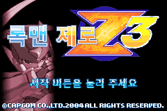
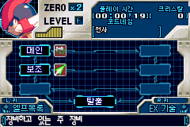

# 록맨 제로 3 · 한글패치 v1.0.0

원본 제로로 즐기는 록맨 제로 3 한글화 배포판이다. 기존 한국어 대사·설명을 바탕으로 한글 타이틀·시작 로고·고정 메뉴·코드네임을 정리했다. 원작의 캐릭터·전투·이동·진행·보상·해금 조건을 유지한다.

## 다운로드

**[정식 v1.0.0 배포 ZIP 다운로드](https://github.com/holizero/rockman-zero3-korean-patch/releases/download/v1.0.0/korean-localization-v1.0.0.zip)** · [릴리스 안내](https://github.com/holizero/rockman-zero3-korean-patch/releases/tag/v1.0.0) · [ZIP 체크섬](https://github.com/holizero/rockman-zero3-korean-patch/releases/download/v1.0.0/korean-localization-v1.0.0.zip.sha256)

첨부 파일에서 **`korean-localization-v1.0.0.zip`**을 선택한다. GitHub 자동 생성 `Source code (zip)`은 패치 배포 파일이 아니다. 배포 ZIP에는 게임 원본·완성 롬·세이브·에뮬레이터를 포함하지 않는다.

## 설치와 원본 복원

1. 배포 ZIP을 모두 압축 해제한다.
2. `한글화_패치도구.html`을 Edge 또는 Chrome으로 연다.
3. 일본판 또는 아래에 지정한 기존 한국어판 원본 `.gba`를 선택한다.
4. `패치 적용`을 누르고 결과를 새 파일로 저장한다.
5. 에뮬레이터에서 새 파일을 실행한다.

설치·인터넷·서버 없이 브라우저 안에서 처리한다. 입력 원본과 세이브를 덮어쓰지 않는다. 복원할 때는 `일본판으로 복원` 또는 `기존 한국어판으로 복원`을 선택하고 이 배포판의 완성 파일을 입력한 뒤 `원본 복원`을 실행한다.

## 지원 원본

| 입력 | 크기 | SHA-1 |
| --- | --- | --- |
| Rockman Zero 3 일본판 · BZ3J | 8,388,608바이트 | `ff7a801776dc76e6d8c7ef73a6660ae732934a3f` |
| 지정된 기존 한국어판 | 9,437,184바이트 | `e30a4c928afe3bd3c1c2b1dbb60bd602ddb9a708` |

파일명이 같아도 크기·해시가 다르면 지원하지 않는다. 북미판·개발판·다른 개조판은 설치 입력으로 지원하지 않는다. 레비아탄·하르퓨이아·오메가 제로 모드와 중복 적용하지 않는다.

## 한글화 범위

- 기존 한국어판 대사·설명 유지
- 한글 타이틀과 시작 안내, 인티 크리에이츠 시작 로고
- 타이틀 하단의 잘린 획과 테두리 복원
- 장비·EX·설정·엘프의 고정 메뉴와 코드네임 한글화
- 원본 ZERO 표기·제로 얼굴·신체 도식·무기·EX 아이콘 보존

동적 문구는 기존 한국어판을 유지한다. 게임 전체를 새로 번역한 배포는 아니다. 추가 장비·EX·아이템은 원작 진행 중 획득하며 전체 지급·인트로 스킵은 포함하지 않는다.

## 저장과 검증

기존 롬·배터리 저장(.sav)을 먼저 백업한다. 새 롬과 같은 기본 이름으로 저장 사본을 준비하며, 이전 즉시 저장 대신 게임 내 저장을 사용한다. 모든 저장 조합의 호환성은 미검증이다.

공개 전 Node 배포 검사 14개 통과: 일본판·한국어판 설치와 두 원본 복원 전체 바이트 일치, 잘못된 입력·중복·손상 차단, ZIP CRC·UTF-8·체크섬·동일 ZIP 재현. 동일 게임 데이터의 기존 mGBA 실행 근거는 메뉴·게임 133,000프레임, 시작 로고 2,000프레임, 타이틀 7,200프레임(합계 142,200프레임)이다. 이번 공개 작업에서 게임을 새로 실행한 결과는 아니다. 전체 캠페인·실기·모든 저장 조합은 미검증이다.

ZIP SHA-256: `82c2cca8e226e1c5e932c0a94e4d02336c55a02b1e4b3340bc6b944c5e069eb8`

## 블로그 안내

한글패치 소개·설치 가이드 페이지는 현재 초안으로 준비 중이다. 공개 후 이곳에 연결한다.

## 제작 정보

원작: CAPCOM / INTI CREATES. 기존 한국어 번역·메뉴 자산과 Galmuri 추가 메뉴 글꼴을 사용한다. 글꼴 허가문은 ZIP의 `글꼴_OFL.md`에 포함한다. 기존 번역의 미확인 제작자·라이선스를 임의로 단정하지 않는다.

[레비아탄 한글 모드](https://github.com/holizero/rockman-zero3-leviathan-ko) · [하르퓨이아 한글 모드](https://github.com/holizero/rockman-zero3-harpuia-ko) · [오메가 제로 한글 모드](https://github.com/holizero/rockman-zero3-omega-ko)
